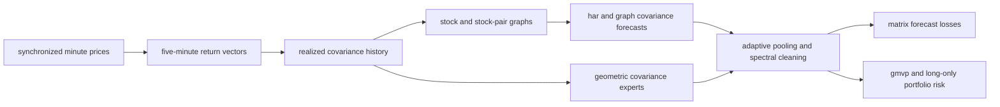
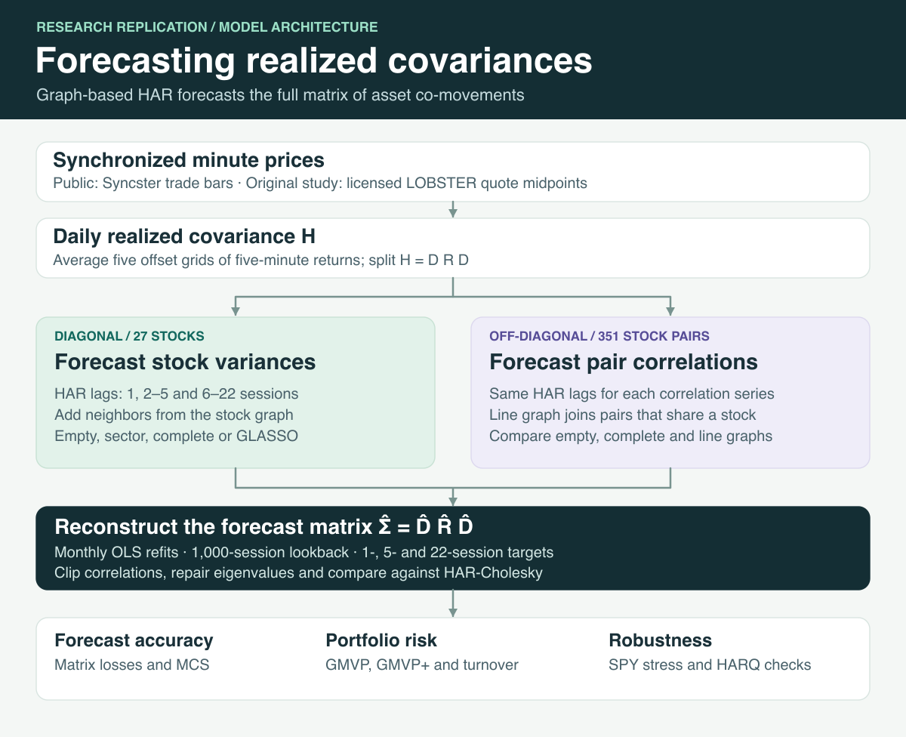
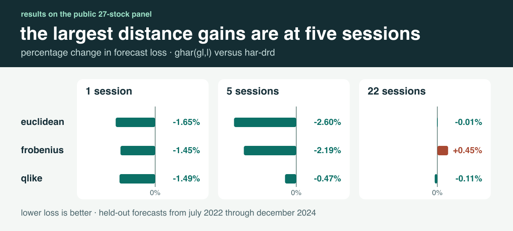

<div align="center">

# graph covariance forecasting

**realized covariance replication · graph spillovers · geometric spectral learning**

[replication](covariance_replication/Covariance_Replication.ipynb) · [shape extension](covariance_replication/Extended_Covariance.ipynb) · [spectral extension](covariance_replication/Spectral_Covariance.ipynb) · [interactive figures](research_dashboard.html) · [proofs](covariance_replication/docs/theory.md)

**27 stocks &nbsp; / &nbsp; 13 reference specifications &nbsp; / &nbsp; 3 horizons &nbsp; / &nbsp; 9 interactive figures**


</div>

forecast the full matrix of asset co-movements, then test whether improved covariance estimates produce lower-risk portfolios. this project follows that question from synchronized intraday prices through graph-based har models, adaptive covariance shapes and a geometric spectral extension.

based on **_graph-based methods for forecasting realized covariances_** by Zhang, Pu, Cucuringu and Dong. [journal article](https://doi.org/10.1093/jjfinec/nbae026) · [upstream reference implementation](https://github.com/chaozhang-ox/Graph-based-HAR/tree/751f8f0b400a33e2f2fd01501ffdc42a2315f013)

> **research scope:** this is a public-data method replication and extension. the original licensed lobster quote panel is unavailable. the feed, dates and retained calendar differ, and the public experiment does not reproduce the paper's full model ranking or portfolio advantage.

## explore the study

| start here | what you will find |
| --- | --- |
| [covariance replication](covariance_replication/Covariance_Replication.ipynb) | har-cholesky, har-drd and graph specifications at 1, 5 and 22 retained sessions |
| [adaptive shape extension](covariance_replication/Extended_Covariance.ipynb) | delayed-feedback expert mixing, unit-trace covariance shapes and portfolio checks |
| [geometric spectral extension](covariance_replication/Spectral_Covariance.ipynb) | regime-dependent pooling, learned eigenvalue cleaning and equal accuracy/risk objectives |
| [offline interactive gallery](research_dashboard.html) | all nine saved plotly figures; download and open the html for interactivity |
| [mathematical proofs](covariance_replication/docs/theory.md) | graph contraction, a loss–risk counterexample, conditional risk and regret bounds |
| [protocol audit](covariance_replication/docs/protocol-audit.md) | the original method, implementation choices, calendar differences and limitations |

## from prices to portfolio outcomes



the target contains each stock's variance and every pair's covariance. daily univariate volatility series cannot supply that cross-asset information. the pipeline synchronizes minute prices for the manuscript's **27 stocks** and constructs realized covariances from five-minute return vectors.

<details>
<summary><strong>the original graph covariance pipeline</strong></summary>



variance forecasting uses empty, sector, complete or graphical-lasso stock graphs. correlation forecasting uses empty, complete or line graphs on stock pairs. the reference grid contains twelve variance/correlation combinations plus har-cholesky. fits use past observations and purge incomplete forward labels.

</details>

## what the replication supports

the initial public backtest has **623 one-session forecasts** during july 2022–december 2024. relative to har-drd, ghar(gl,l) lowers one-session euclidean loss by **1.65%** and five-session euclidean loss by **2.60%**. its 22-session frobenius loss is **0.45% higher**.

har-cholesky performs best under the initial one-session distance losses, and the graph model is excluded from those two model confidence sets. long-only graph portfolio risk is **9.39%**, compared with **9.33%** for har-drd. these outcomes support a qualified short-horizon forecast gain, rather than the original paper's full dominance claim.



[paper-versus-public comparison](covariance_replication/docs/result-comparison.md) · [source and calendar details](covariance_replication/README.md)

## the newer architecture: geometric pooling and spectral cleaning

the extension combines five positive-definite covariance experts with a **175-parameter regime gate**, a learned eigenvalue cleaner and a condition-number guard. training gives forecast distance and a long-only portfolio-return objective equal weight. a seven-parameter static pool is included as a simpler control.


means below use the **same 443 one-session origins in the reused 2025–october 2026 benchmark**. matrix ratios use har-drd as the denominator; lower is better. risk is annualized long-only standard deviation, in percent, before transaction costs.

| model | euclidean ratio | frobenius ratio | qlike ratio | annual risk (%) |
| --- | ---: | ---: | ---: | ---: |
| har-drd | 1.0000 | 1.0000 | 1.0000 | 9.4351 |
| ghar(gl,l) | 1.0113 | 1.0109 | 1.1609 | 9.7468 |
| har-cholesky | 1.0137 | 1.0062 | 1.0764 | 9.4047 |
| uniform shape | 0.9982 | 0.9987 | 0.9926 | 9.4664 |
| adaptive shape | 0.9977 | 0.9979 | **0.9918** | 9.4912 |
| arithmetic har covariance | 1.0827 | 1.0906 | 1.0158 | **9.2113** |
| log-euclidean har covariance | 0.9860 | 0.9808 | 1.0897 | 9.4763 |
| static geometric pool | **0.9766** | **0.9740** | 0.9999 | 9.4587 |
| geometric spectral gate | 0.9839 | 0.9821 | 0.9961 | 9.4061 |

the neural gate improves both averages against har-drd: frobenius distance is **1.79% lower**, and annualized long-only risk falls from **9.435% to 9.406%**. the paired risk interval includes zero, so the predefined joint accuracy-and-risk criterion is **not passed**. these are retrospective results, since the benchmark had already been inspected during earlier research.

the static pool has lower matrix-distance losses than the neural gate, while the arithmetic pool has the lowest risk in this table. there is no universal best model across all objectives.

[full results and paired intervals](covariance_replication/docs/spectral/results.md) · [fixed design](covariance_replication/docs/spectral/design.json) · [saved comparison tables](covariance_replication/docs/spectral/tables)

## what the proofs establish

| result | supported conclusion |
| --- | --- |
| line-graph spectrum | one linear aggregation pass contracts centered pair features by at most 0.46 for 27 stocks |
| loss–risk counterexample | all three covariance losses can improve while true minimum-variance portfolio risk increases |
| relative spectral condition | a stated relative matrix bound yields a conditional oracle portfolio-risk bound |
| positive covariance mixing | trace-one expert mixtures preserve positive definiteness and the selected total variance |
| delayed online learning | finite-sequence shape-loss regret bounds, with a sharper one-session bound of 2 log 3 |
| spectral guard | the new forecast construction bounds conditioning by 100 under its positive-input assumptions |

these are proved specializations of established mathematical ideas. priority is unassessed, and the conditional guarantees do not imply lower future portfolio risk. [complete proof note](covariance_replication/docs/theory.md) · [spectral construction](covariance_replication/docs/spectral/research.md)

## graphs, presentation and site preparation

all saved covariance graphs are available in the [offline gallery](research_dashboard.html), with individual [figure payloads](figures) and a source-notebook index. open the downloaded html locally; the plotly library is bundled, so market downloads and a live server are unnecessary.

- [figure inventory](figures/README.md): where each graph comes from and how to regenerate the gallery.
- [presentation content plan](docs/presentation-plan.md): a slide sequence with the exact source figures, tables and supported claims.
- [site content plan](docs/site-plan.md): navigation and reusable assets for a future website.

these plans prepare the material for the presentation and site. a current-project slide deck and live website have not been published.

## reproduce

use **python 3.10 or 3.11** and work from the covariance folder:

```sh
git clone https://github.com/khaamr/gnn-volatility-spillovers.git
cd gnn-volatility-spillovers/covariance_replication
python3 -m venv .venv
source .venv/bin/activate
python -m pip install -r requirements.txt
python -m ipykernel install --user --name covariance-har --display-name 'python (covariance har)'
python -m unittest discover -s tests -v
```

open one of the three covariance notebooks with this kernel and run all cells from that folder. the first run caches approximately **0.5 gb** of pinned public minute bars. to regenerate only the figure gallery from saved notebook outputs, run:

```sh
python export_figures.py
```

## data and limitations

- **public inputs:** pinned syncster minute trade bars for the manuscript's 27 stocks and spy.
- **original inputs:** licensed lobster quotes, supported through the documented local-data adapter.
- **calendar:** strict shared-session screening removes dates, especially before 2022; a model horizon counts retained observations.
- **calibration:** the initial 1,000-observation window spans more than six calendar years, rather than the paper's approximately four exchange years.
- **evaluation:** portfolio returns are open-to-close and exclude transaction costs. the newer architecture's benchmark is reused, and independent confirmation remains necessary.

[pinned public data](https://huggingface.co/datasets/syncster-data/historical-market-data/tree/eff0dac55d843b3b83caec819efa213021a3e3e5) · [data and protocol audit](covariance_replication/docs/protocol-audit.md)
