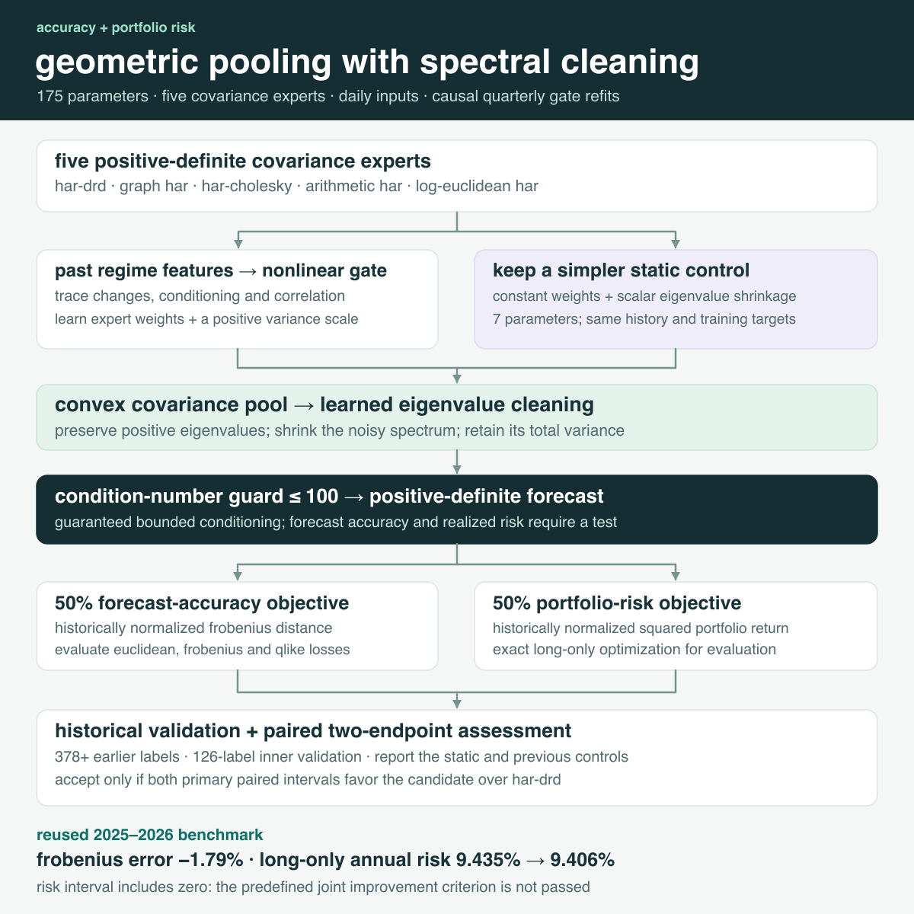
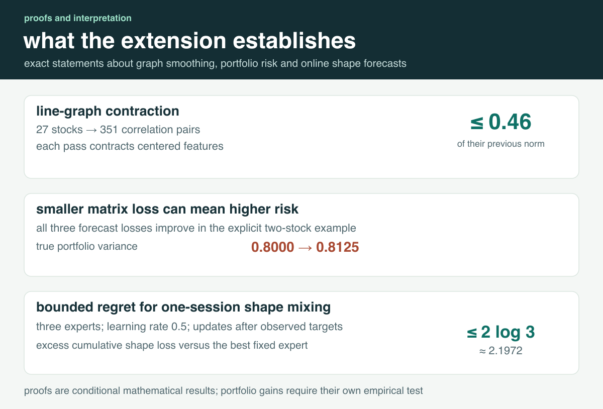

# graph covariance forecasting

replication and extension of **graph-based methods for forecasting realized covariances** by Zhang, Pu,Cucuringu and Dong. this project forecasts the full covariance matrix of 27 stocks and tests whether graph spillovers improve matrix accuracy and minimum-variance portfolios.

[replication notebook](covariance_replication/Covariance_Replication.ipynb) · [shape extension](covariance_replication/Extended_Covariance.ipynb) · [geometric spectral extension](covariance_replication/Spectral_Covariance.ipynb) · [proofs](covariance_replication/docs/theory.md) · [journal article](https://doi.org/10.1093/jjfinec/nbae026)

## replication

the implementation includes har-cholesky, har-drd, eleven graph specifications, three horizons, model confidence sets, and constrained and unrestricted minimum-variance portfolios. the data are pinned public minute bars for the same 27 stocks as the manuscript; licensed lobster quote inputs are also supported. synchronized intraday vectors are needed to measure covariance between assets.

the public-data experiment does not reproduce the paper's full model ranking or portfolio advantage. [data choices and setup](covariance_replication/README.md) · [protocol audit](covariance_replication/docs/protocol-audit.md) · [comparison with the paper](covariance_replication/docs/result-comparison.md)

## extension

the extension separates covariance shape from total variance and combines three experts using past observed losses. it includes complete proofs for graph smoothing, a loss–risk counterexample, a conditional portfolio-risk bound, positive mixing and finite-sequence regret bounds. these specialize established mathematical ideas; priority is unassessed.

confirmation uses 443 one-session forecasts in 2025–october 2026. adaptive matrix-loss ratios against har-drd are **0.9977, 0.9979 and 0.9918**. the primary adaptive-versus-uniform shape-loss confidence interval includes zero, and long-only portfolio risk does not improve. the notebook reports the complete mixed result with plotly graphs and saved tables.

## geometric and spectral extension

the latest [geometric spectral experiment](covariance_replication/docs/spectral/research.md) gives forecast accuracy and portfolio risk equal importance. it combines geometric covariance experts, a 175-parameter regime gate and learned eigenvalue cleaning. on the reused 2025–2026 benchmark, frobenius distance is **1.79% lower** and long-only annualized risk falls from **9.435% to 9.406%** against har-drd. the risk confidence interval includes zero, so the predefined joint criterion is not passed. a simpler static pool has lower matrix-distance losses. [complete results and uncertainty](covariance_replication/docs/spectral/results.md).

## run

use python 3.10 or 3.11 and work from the covariance folder:

~~~sh
cd covariance_replication
python3 -m venv .venv
source .venv/bin/activate
python -m pip install -r requirements.txt
python -m ipykernel install --user --name covariance-har --display-name "python (covariance har)"
python -m unittest discover -s tests -v
~~~

open a notebook with this kernel and run all cells from that folder. the first run caches approximately 0.5 gb of public data. the spectral notebook uses pytorch on cpu and also exports its fold audit, paired comparisons and solver diagnostics.
