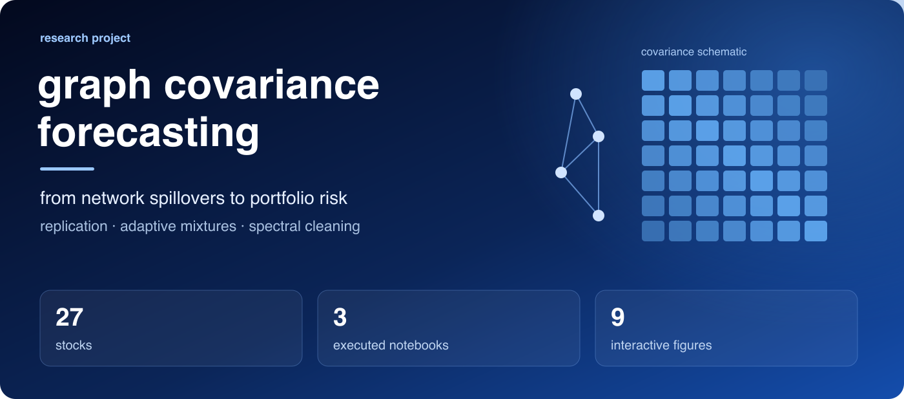

<div align="center">

# graph covariance forecasting

**27 stocks · 13 reference models · 3 forecast horizons**

[project site](https://khaamr.github.io/graph-covariance-forecasting/) · [interactive dashboard](https://khaamr.github.io/graph-covariance-forecasting/research_dashboard.html) · [graph explainer](https://khaamr.github.io/graph-covariance-forecasting/previews/graph-explainer.html)

[](https://khaamr.github.io/graph-covariance-forecasting/research_dashboard.html)

</div>

we forecast how 27 stocks move together and check whether better covariance forecasts lead to lower portfolio risk. the study starts with a public data replication of [Zhang, Pu, Cucuringu and Dong](https://doi.org/10.1093/jjfinec/nbae026), then tests adaptive covariance shapes and spectral cleaning.

## research dashboards

| dashboard | what it shows |
| --- | --- |
| [replication](https://khaamr.github.io/graph-covariance-forecasting/research_dashboard.html#section-replication-01) | forecast losses by horizon, portfolio risk and turnover |
| [shape extension](https://khaamr.github.io/graph-covariance-forecasting/research_dashboard.html#section-shape-extension-01) | graph contraction, adaptive expert weights and covariance loss |
| [spectral extension](https://khaamr.github.io/graph-covariance-forecasting/research_dashboard.html#section-spectral-extension-01) | expert weights, model loss and long-only portfolio risk |

## results

**replication.** GHAR(GL,L) reduced Euclidean loss by **1.65%** at one session and **2.60%** at five sessions versus HAR-DRD. at 22 sessions, its Frobenius loss was **0.45% higher**. the public data use a different feed and trading calendar from the licensed LOBSTER sample. the full model ranking and portfolio advantage did not replicate. [replication results](covariance_replication/docs/result-comparison.md) · [data and protocol](covariance_replication/docs/protocol-audit.md)

**spectral extension.** across **443 shared forecast dates** on the reused 2025 to October 2026 benchmark, the spectral gate lowered Frobenius loss by **1.79%** versus HAR-DRD. annualized long-only risk moved from **9.435% to 9.406%** before transaction costs. the paired risk interval crossed zero. [results and paired intervals](covariance_replication/docs/spectral/results.md)

## notebooks

| notebook | what it covers |
| --- | --- |
| [covariance replication](covariance_replication/Covariance_Replication.ipynb) | HAR and graph forecasts at 1, 5 and 22 retained sessions |
| [adaptive shapes](covariance_replication/Extended_Covariance.ipynb) | covariance shape mixtures with delayed feedback |
| [spectral extension](covariance_replication/Spectral_Covariance.ipynb) | geometric pooling, eigenvalue cleaning and portfolio evaluation |

[all nine dashboard figures](https://khaamr.github.io/graph-covariance-forecasting/research_dashboard.html) · [figure sources](figures/README.md) · [mathematical notes](covariance_replication/docs/theory.md)

## reproduce

use Python 3.10 or 3.11.

```sh
git clone https://github.com/khaamr/graph-covariance-forecasting.git
cd graph-covariance-forecasting/covariance_replication
python3 -m venv .venv
source .venv/bin/activate
python -m pip install -r requirements.txt
python -m unittest discover -s tests -v
```

open a notebook using that environment. the first run caches about 0.5 GB of minute bars. run `python export_figures.py` from the same folder to rebuild the interactive dashboard from saved notebook outputs.
